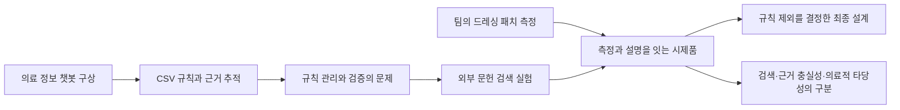
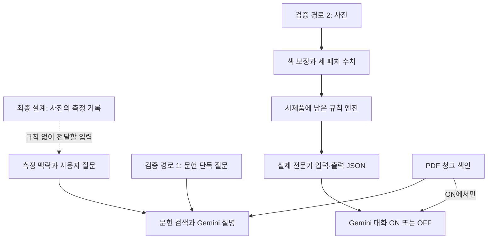

# 진심탐 종합 탐구보고서
## 스마트 드레싱의 측정값과 의료 문헌을 자연어 설명에 연결하는 과정

**자료 기준일은 2026년 11월 13일이다.** 7월의 동기, 팀의 역할 분담, 최종 설계 결정과 최근의 활용 대상은 참여자의 활동 설명에 근거했다. 구현 시점은 Git 이력을, 실행 여부와 수치는 저장된 입출력을 기준으로 삼았다. 이 구분은 특히 사진 실험을 해석할 때 중요하다. 팀은 최종 설계에서 규칙 기반 전문가 시스템을 제외하기로 했지만, 이날 사진에서 답변까지 연결한 실행본에는 규칙 엔진이 남아 있다.

## I. 탐구 개요

2026년 7월 무렵 출발점은 “의료진이 관리하는 정보를 사람들이 자신의 말로 물어보고 이해할 수 있을까?”였다. 처음 관심을 가진 일은 의학 지식의 저장과 전달이었다. 지식 관리자가 읽고 고칠 수 있는 표를 만들고, 챗봇이 사용자 표현을 해석해 해당 내용을 설명하는 방식을 구상했다. 이후 팀에서 진행하던 스마트 드레싱과 연결하면서 질문이 구체화됐다. 사진 한 장에서 어떤 수치를 얻었는지, 그 수치가 시간에 따라 어떻게 변했는지, 문헌은 사용자의 어떤 질문에 답할 수 있는지를 함께 다루게 되었다.

도서·산간 지역처럼 의료기관을 자주 방문하기 어려운 사람들을 주요 활용 대상으로 생각한 것은 탐구 후반이다. 이동이 어려운 환경에서 자신의 기록을 정리하고 다음 상담에 가져갈 질문과 자료를 찾는 용도를 상정했다. 이번 실험 대상은 사진, 가상 수열, 연구팀이 작성한 환자형 질문이다. 해당 지역 주민의 사용성, 진료 접근의 개선, 방문 필요성의 판별 또는 건강 결과는 측정하지 않았다.

개인 탐구의 중심은 지식 표현, 규칙과 RAG 설계, Gemini 설명 생성, 후단 연결 및 실험이었다. 패치의 측정 원리와 영상 처리는 팀의 다른 활동과 만나는 부분이다. 공동 작업에서 맞춰야 했던 것은 특히 측정값의 의미와 단위였다. 예컨대 코드의 `co2_value`는 페놀레드 용액의 pH이며, 상처 자체의 pH를 뜻하는 BTB 측정 채널과도, 직접 측정한 CO₂ 농도와도 구분해야 한다. 개별 영상 함수의 작성자를 커밋만으로 배정하지 않았다.

## II. 탐구의 발전 과정

1. **7~8월, 지식을 표로 표현하다.** 사용자 설명상 7월에 챗봇을 구상했고 확인되는 최초 커밋은 8월 1일이다. 8월 16일에는 CSV 규칙을 JSON으로 옮기고 임계값을 저장했으며, 다음 날에는 가상 입력을 채널별 등급으로 바꾸고 조건식과 사실을 처리했다. 규칙표의 장점은 어떤 입력이 어떤 결론을 만들었는지 역추적할 수 있다는 점이었다. 동시에 표에 임계값을 쓰는 사람이 그 숫자의 근거까지 책임져야 한다는 문제가 생겼다.
2. **10월, 추론과 설명을 나누다.** 10월 17일에는 연쇄 추론과 미확인 정보 처리를 분리했다. 10월 31일에는 Google API 연결과 간단한 RAG 실험 기록이 남았다. 개발 중 한 문장으로 아는 사람을 소개하는 시험에서는 같은 질문이라도 자료를 넣으면 그 문장의 내용을 답할 수 있었다. 이는 문맥 전달의 동작 예시였고, 의료 문헌 검색 실험은 이후 별도로 설계했다.
3. **11월, 팀의 이미지 출력과 문헌 검색을 연결하다.** 11월 7일 커밋은 RAG 구현과 당시 남아 있던 이력 연결 작업을 명시한다. 의료 PDF의 파일명과 쪽수를 보존하고, 이미지 측정값 및 이력을 JSON으로 받아 사람이 읽는 설명으로 바꾸는 경로를 만들었다. CSV와 문헌의 갱신 문제는 성격이 달랐다. 규칙 변경에는 판정의 재검증이 필요했고 문헌 변경에는 색인과 근거 문항의 갱신이 필요했다.
4. **11월 13일, 구성 요소를 따로 시험하다.** 문헌 검색의 효과를 보려고 전문가 입력 없는 ON/OFF 비교를 진행했다. 기존 프롬프트의 영향이 제기돼 최소 지시의 두 번째 실험을 했다. 시계열에서는 세 센서의 R과 D 및 분·일 환산을 다시 확인했다. 마지막에는 지정 사진으로 시제품의 양쪽 대화를 실행하고, 검색 문단과 사용자에게 보인 문장을 대조했다.
5. **설계 결정과 후속 문제의식.** 팀은 전문가가 작성·검증하는 절차를 갖추지 못한 규칙을 최종 판단 단계에 두기 어렵다고 판단했다. 최종 방향은 측정 기록을 설명하고 외부 문헌을 검색하는 구조다. RAG는 원문을 가져오는 기능이므로 센서 보정, 임상 판정 규칙의 검증, 임상 판단의 책임은 여전히 별개의 문제로 남는다. 개발자가 직접 확인할 수 있는 것과 전문가에게 검토받을 것을 어디서 나눌지에 관한 연구 질문은 이러한 시행착오 뒤에 구체화됐다. 제외를 의결한 정확한 날짜나 회의록은 확인되지 않는다.

## III. 이론적 배경

**패치에서 특징을 읽는 방법.** 카메라가 기록하는 색은 패치와 조명의 영향을 함께 받는다. Gray World 보정은 영상 전체의 세 채널 평균을 같은 밝기로 맞춘다. 영상 대부분이 특정 색이면 이 가정도 흔들릴 수 있다. 다음으로 LAB 색공간에서 밝기 L에만 CLAHE를 적용해 국소 대비를 조정한다. 세 관심 영역 안의 평균 RGB를 구해 채널 합으로 나눈 비율을 특징으로 사용한다. 특징이 반복 가능하게 계산되는지와 그 값이 실제 pH나 온도를 맞히는지는 각각 다른 기준 측정이 필요하다. [영상 코드](<i know brg hsv rgb.py>)

**규칙과 검색이 표현하는 지식.** 규칙 엔진은 “조건이 참이면 사실·결론·행동을 추가한다”는 방식으로 결과를 만든다. 규칙 ID를 따라가면 결과를 재현할 수 있다. RAG는 PDF 일부를 벡터화해 질문과 가까운 문단을 찾아 생성 모델에 제공한다. 모델이 기존 지식과 문단을 함께 사용할 수 있으므로 인용된 페이지를 찾아서 실제 문장까지 대조해야 한다. 검색기도 생성 모델도 이 프로젝트에서 새로 학습시키지 않았다. [규칙 엔진](DressingExpert/inference.py) · [문헌 준비](DressingExpert/prepare_rag.py) · [대화 구현](DressingExpert/chat.py)

**세 가지 평가 질문.** 지정한 근거가 검색되었는지는 순위로 셀 수 있다. 답변 충실성은 “이 문장이 해당 청크에서 실제로 도출되는가”를 따져야 한다. 의학적 안전성은 여기에 환자의 상황, 적용 대상, 행동의 적절성까지 더한 질문이다. 이번 탐구는 순위 집계와 문장별 정성 대조를 사용했다. 의료 전문가 채점, 임상 정확도, RAGAS 점수는 산출하지 않았다.

## IV. 최종 시스템 설계 및 구현

실선의 두 검증 경로에는 실행 로그가 있다. 점선은 최종 설계에서 필요한 연결이다. 문헌 단독 경로에서는 `chat.py --rag-only`가 전문가 결과 없이 동작한다. 반면 사진 실행 파일은 `measure_patches → chat.main(patch_values=…) → run → assess → Conversation.answer`를 호출한다. **측정값은 전달하면서 규칙 결과만 제거한 최종 사진 경로의 실행 기록은 확보되지 않았다.** 계획했던 실험을 수행했다는 사실과 이 특정 설계의 통합 검증 여부를 구별했다. [사진 실행 파일](<i know brg hsv rgb.py>) · [전문가 시스템 호출](DressingExpert/dressingExpert.py) · [통합 실험](실험결과/사진_전체과정_RAG비교/실험보고서.md)

### 이미지와 사용자 입력

실제 사진 실험은 영상 전체의 가로·세로 비율로 고정한 세 사각형에서 값을 읽었다. 설명 문서에 나오는 패드 외곽선 자동 검출은 이 실행 함수에서 호출하지 않는다. 보정 전후를 모두 출력하고, 후단에는 보정 후 수치를 전체 정밀도로 전달한다. 정규화 RGB를 각각 $r,g,b$라 하면 환산식은 다음과 같다.

| 채널 | 사진 코드의 수치 변환 | 해석상 제약 |
|---|---|---|
| BTB | $6+12(b-r)$를 4~10으로 제한 | 해당 색 범위를 벗어나면 출력이 포화된다. |
| 페놀레드 | $6.8+10(r-g)$를 6.8~8.4로 제한 | CO₂ 간접 지표인 패치 pH다. 이 코드로는 수동 시나리오의 pH 6.0을 만들 수 없다. |
| 온도 | $g>r$이면 36.5℃, 그 외에는 37.5℃ | 두 값만 출력하므로 0.1℃ 단위의 시계열 시나리오는 사진 측정 분해능 실험이 아니다. |

별도의 대화형 입력은 측정 횟수, 측정일, 드레싱 교체 여부를 받고 이전 기록과 현재값을 분리한다. JSON에는 의료진 승인 같은 선택 필드도 있다. 이는 구조화된 사용자 입력 기능이다. 통합 사진 실험에서는 세 수치만 들어갔고 증상 설문지, 검증된 설문 점수 또는 환자 설문 자료로 회귀한 기록은 확인되지 않았다. [입력 모드](DressingExpert/input_modes.py) · [실제 전달 JSON](실험결과/사진_전체과정_RAG비교/ON/전문가시스템_입출력.json)

### 시간 분석과 연구용 점수

측정 시점 $t$는 일 단위다. 최근 기울기 $s=(X_n-X_{n-1})/(t_n-t_{n-1})$는 두 점부터 정해진다. 현재점을 제외한 이전 2~3점에 대해 최소제곱 직선 기울기 $b=\sum(t_i-\bar t)(X_i-\bar X)/\sum(t_i-\bar t)^2$를 구하고 $D=s-b$로 최근 변화가 기존 추세에서 얼마나 벗어났는지 나타낸다. 따라서 일정한 속도로 계속 상승하면 값 자체가 높아져도 D는 0에 가까울 수 있다.

연구 점수는 $R=40/[q(L-X_n)]+40qs$다. BTB와 온도는 $q=1$, 한계 $L$은 각각 8.5와 40이며 페놀레드는 $q=-1$, $L=5.5$다. 경고 방향으로 하루 0.5단위 변하면 변화율 항에 20점이 더해진다. 한계에 도달하거나 넘으면 별도 상태를 반환한다. R은 20점 단위 구간으로 분류하고 100 이상은 범위 초과로 처리한다. 음수도 가능하다. 세 센서에 수치 출력이 있지만 시제품의 Q01·Q02는 BTB와 온도의 점수·편차 경고를 조건으로 쓴다. [계산 함수](DressingExpert/temporal.py) · [계수 설정](DressingExpert/files/algorithm_config.json) · [규칙표](DressingExpert/files/rules.csv)

### 문헌에서 답변까지

로컬 PDF 5개를 페이지별로 읽어 빈 본문을 건너뛰고 파일명·PDF 쪽수를 저장했다. LangChain의 재귀 문자 분할기는 최대 1,000자, 겹침 150자 설정이다. 저장된 585개 청크는 감염 실무 지침 261개, 센서 관련 논문 파일 153개, 상처 치유 원리 95개, 상처 치유 생리 40개, 만성 상처 평가·관리 36개로 구성된다. `gemini-embedding-001`로 20개씩 임베딩한 색인을 파일에 저장했다. 질의에서는 색인을 다시 열어 코사인 유사도 상위 3개를 찾는다. 예전 색인의 청크 ID는 파일명·페이지·본문이 일치하는 원본 청크와 연결한다. [색인 생성 코드](DressingExpert/prepare_rag.py) · [청크 원문](DressingExpert/RAGtexts/chunks.json)

문헌 단독 독립 비교에서는 같은 질문을 사용한다. 사진 대화에서는 현 질문, 최근 사용자 질문 최대 두 개, 판정·등급·행동을 검색어로 묶는다. ON은 검색 본문과 파일명·쪽수를 사용자 메시지에 추가하고 OFF는 생략한다. 사진 경로는 두 모드 모두 같은 측정 JSON과 설명용 프롬프트를 받는다. 응답과 검색 원문은 턴별로 기록된다. 이미지 자체는 Gemini 입력에 포함되지 않는다. [대화 코드](DressingExpert/chat.py) · [측정 설명용 프롬프트](DressingExpert/files/prompt.txt) · [문헌용 프롬프트](DressingExpert/files/prompt_rag.txt)

## V. 실험 설계 및 수행

| 실험과 질문 | 자료 및 비교 조건 | 평가 방법 |
|---|---|---|
| 문헌 RAG 1차. 상세 프롬프트를 공통으로 줘도 검색이 도움이 되는가? | 환자형 6문항, 예시 3개. 각 질문별 이력 없는 OFF·ON 1회씩, 답변 12개 | 미리 정한 청크 ID의 상위 1·3위 포함 여부, 인용·누락·과도한 단정 대조 |
| 문헌 RAG 2차. 예시를 없애면 어떤 설명과 출처가 나오는가? | 기존 6개와 문헌 본문 기반 신규 3개. 한국어·출처·진단 제한만 지시. 독립 답변 18개, 검색 결과 27개 | 공통 문항에서 순위와 답변 변화를 살피고 신규 문항은 별도 집계 |
| 세 센서 시간 분석. 계산이 식과 일치하며 급변을 구별하는가? | 7일 수열 5개. BTB·페놀레드·온도 각각 매일 그날까지의 자료만 주어 CLI 105회 | CLI와 함수 결과 대조, 분수 연산으로 R·D 독립 검산, 경계 등급 확인 |
| 사진 통합. 같은 측정에서 자료 제공이 환자 대화에 미치는 영향은? | 지정 PNG 1장. 모드별 사진 처리부터 다시 실행. 첫 해설과 같은 후속 질문 4개씩 총 답변 10개 | 입력 JSON 동일성, 규칙 ID, 턴별 검색어·청크·쪽수와 답변 문장의 대조 |

문헌 두 실험 및 사진 실험에서 확인된 생성 모델은 `gemini-3.5-flash-lite`다. 문헌 단독 실험은 문항 사이에 대화 이력을 비웠고 사진 실험은 모드마다 자기 답변 이력을 유지했다. 전자는 검색 문헌 유무를 비교하기 좋고 후자는 이전 답변의 잘못된 가정이 후속 대화에 미칠 여지도 포함한다. 생성의 무작위성을 추정할 독립 반복은 없다. [1차 기록](실험결과/RAG_6문항/세션원본.txt) · [2차 기준과 질문](실험결과/RAG_2차_제로샷/문항과_사전기준.md) · [사진 실험 질문](실험결과/사진_전체과정_RAG비교/환자질문.txt)

## VI. 실험 결과 및 분석

### 1. 문헌 검색 순위와 생성 답변

Hit@k는 **미리 지정한 근거 청크가 상위 k개에 포함된 질문 수 ÷ 질문 수**다. 문서 없이 생성하는 OFF에는 이 값을 계산할 검색 결과가 없다. 아래 값은 검색기의 결과이며, ON/OFF 답변의 정답률로 읽으면 안 된다.

| 질문 구성 | Hit@1 | Hit@3 |
|---|---:|---:|
| 1차 6문항 | 2/6 (33.3%) | 4/6 (66.7%) |
| 2차 공통 6문항 | 2/6 (33.3%) | 4/6 (66.7%) |
| 2차 신규 3문항 | 1/3 (33.3%) | 3/3 (100%) |
| 2차 전체 9문항 | 3/9 (33.3%) | 7/9 (77.8%) |

공통 6문항은 상위 세 ID와 순서까지 같았다. 생성 지시를 바꿔도 문헌 단독 모드의 검색어에는 질문만 들어가기 때문이다. 신규 문항은 문헌에서 답할 수 있는 주제를 의도적으로 골랐다. 전체 비율이 오른 이유에는 표본 구성이 들어 있으므로 검색기 개선으로 해석할 수 없다. 아래는 두 차수 자료를 같은 문항 기준으로 정리한 것이다. [1차 분석과 답변 전문](실험결과/RAG_6문항/비교분석.md) · [2차 분석과 답변 전문](실험결과/RAG_2차_제로샷/비교분석.md)

| 질문 주제 | 기준 ID | 실제 상위 ID 순서 | 답변을 원문과 대조한 결과 |
|---|---:|---|---|
| 드레싱을 떼고 말리기 | 280 | 280, 323, 425 | ON은 습윤 유지 근거를 찾았지만 양쪽 모두 과도한 진물로부터 주변 피부를 보호하는 기준 요소를 빠뜨렸다. |
| 진물 증가와 악화 | 487 | 486, 487, 425 | 양쪽 모두 악화를 단정하지 않았다. ON은 수집 방식에 따라 관측량이 달라질 수 있다는 설명을 근거와 연결했다. |
| 발열·발적 없는 치유 지연 | 275 | 37, 203, 36 | ID 점수는 0이지만 36 등이 눈에 잘 띄지 않는 징후를 설명했다. 하나의 모범 ID만 두면 대체 근거가 누락된다. |
| 통증과 냄새의 증가 | 38 | 38, 275, 37 | 둘 다 의료진에게 알리라고 답했다. 38은 두 증상을 직접 지지했고, 2차 ON이 추가 인용한 275는 그 주장과 덜 밀접했다. |
| 석 달 뒤 피부 강도 | 319 | 371, 319, 370 | ON은 약 80%라는 수치와 쪽수를 찾았다. 그러나 문헌의 시간 기점을 환자의 ‘아문 뒤 석 달’에 옮기고 집단 수준 수치를 개인에게 단정했다. |
| pH 하나로 감염 판단 | 481 | 206, 491, 558 | 양쪽 모두 확진을 보류했다. ON의 206은 pH 정의, 491은 센서 원리를 주로 설명하며 558은 참고문헌이었다. 결론이 신중해도 인용 범위는 과장될 수 있다. |
| 진물의 분할 수집 | 487 | 486, 487, 485 | 2차 ON은 희석·혼합·교차오염 감소와 소량 채취의 한계를 함께 설명했다. OFF는 제공되지 않은 첨부 PDF의 1쪽을 언급했다. |
| 센서 코팅과 물질 이동 | 503 | 502, 503, 496 | 두 답변의 방향은 비슷했고 ON은 하이드로겔 사례를 실제 PDF 15쪽에 연결했다. OFF는 첨부 파일이 있다고 전제했다. |
| 새 피부 세포의 이동 | 314 | 314, 368, 367 | ON은 PDF 4쪽을 제시했다. OFF는 근거보다 좁은 12~24시간과 제공되지 않은 파일명을 덧붙였다. |

따라서 검색 효과가 뚜렷했던 부분은 제시한 수치·기전을 다시 확인할 수 있는 경우였다. 반대로 같은 자료가 들어가도 답변 완전성이나 적용 대상의 적절성은 자동 개선되지 않았다. 2차 신규 3문항의 OFF는 모두 제공되지 않은 파일을 언급했다. 이 문항들은 1차에 없고, 2차에서는 예시와 상세 지시를 함께 줄였으므로 이를 퓨샷 제거만의 효과로 분리할 수 없다.

### 2. 다섯 가지 시간 변화

다음은 각 수열 7일차의 **R / D**다. 시나리오 이름은 입력 설계 의도이며 진단 라벨로 사용하지 않았다.

| 수열 | BTB | 페놀레드 | 온도 |
|---|---:|---:|---:|
| 지속 변화 | 92 / −0.05 | 92 / +0.05 | 32 / −0.05 |
| 일부 지표 변화 | 34.67 / +0.05 | 20 / −0.10 | 48 / +0.55 |
| 작은 변동 | 16 / −0.10 | 20 / −0.05 | 6 / 0 |
| 6일차 급변 후 일부 반전 | 62.67 / −1.05 | 62.67 / +1.05 | 15.05 / −0.95 |
| 상승 후 복귀 | 4 / +0.05 | 4 / −0.05 | −2 / +0.05 |

R은 90건, D는 75건 계산됐다. 네 번째 수열의 **6일차**에는 BTB 6.2→8.0, 페놀레드 7.8→6.0, 온도 36.5→38.0으로 변했다. R은 각각 152·152·80이고 D는 +1.7·−1.7·+1.4였다. 급변이 숫자에 잡혔어도 등급은 전체 75건 모두 ‘기존 추세와 유사’였다. 원래 분당 D 경계가 pH 0.02/0.1, 온도 0.2/1이어서 일당으로 일관되게 환산하면 28.8/144, 288/1,440이 된다. 페놀레드는 별도 검증 없이 pH 경계를 차용했다. **같은 측정의 시간 단위를 환산하는 것과 측정 간격을 바꾼 뒤의 판별 기준을 정하는 일은 다르다.** 독립된 일별 기준 자료가 없는 상태에서 다섯 수열에 맞춰 경계를 낮추면 사례를 다시 맞힌 것만 확인하게 된다. [시나리오 분석](실험결과/시나리오_분석.md) · [일별 전체 표](실험결과/일별_입력과_계산결과.md)

### 3. 사진에서 대화까지

`KakaoTalk_20261113_192518326.png`에 같은 연산을 두 번 적용했다. 원본→보정 후 출력은 BTB **5.39→5.75**, 페놀레드 **7.68→7.58**, 온도 **37.5→36.5℃**였다. 온도는 보정만으로 두 출력 범주 사이를 이동했다. 어느 쪽이 실제 온도와 가까운지 결정해 줄 동시 온도계 측정값은 없다. 후단은 보정값을 받아 BTB와 온도에 normal, 페놀레드에 observation을 부여했고 최종 시제품 출력은 observation_pattern이었다. 최초 기준 기록·측정값 저장·다음 날 재확인이 행동 후보로 생성됐다. 사진 하나라 세 센서의 R·D는 모두 보류됐다. [RGB·환산 원수치](실험결과/사진_전체과정_RAG비교/이미지처리/패치별_RGB와_환산값.json) · [전문가 출력](실험결과/사진_전체과정_RAG비교/OFF/전문가시스템_입출력.json)

| 대화 단계 | 관찰된 차이와 오류 |
|---|---|
| 첫 자동 해설 | 양쪽 모두 같은 세 수치를 설명했다. ON은 입력되지 않은 교체 여부를 ‘교체하지 않았다’고 단정했다. 검색 1위 청크 337은 저작권·이해관계 고지였다. OFF는 미입력임을 밝혔었다. |
| 어떤 값이 판정을 결정했나 | 둘 다 페놀레드를 짚고 전날과 비교할 수 없다고 했다. 그러나 사진 분석 결과가 없다는 취지로 설명했다. 모델에 사진 자체가 전달되지 않았더라도 수치의 출처는 그 사진이다. |
| 페놀레드와 CO₂의 관계 | 양쪽 모두 간접 지표라는 점을 설명했다. ON은 상처 자체 pH와도 구별했다. 인용된 청크 206은 pH의 정의를 뒷받침하지만 이 패치의 변환식을 검증하지 않는다. |
| 무엇을 기록할까 | OFF는 진물의 양·색, 냄새와 통증을 열거했다. ON은 206의 홍반·온기·부종을 덧붙였지만 다른 두 검색 문단은 광학 센서에 관한 내용이었다. |
| 붉은 부위가 퍼지거나 열이 난다면 | ON은 청크 206과 40을 통해 증상·종합 평가 관련 원문을 추적할 수 있었다. 둘 다 질문의 ‘열’을 국소 열감으로 좁혀 발열과 구별하지 않았다. |

이 실험에서 가장 명확한 오류는 출처를 붙인 문장이 틀렸다는 사례만이 아니다. **문헌을 가져온 해설조차 환자가 입력하지 않은 사실을 단정할 수 있었다.** OFF와 ON의 입력 JSON, 시스템 지시 및 질문 순서는 같지만 두 번째 턴부터 이력 속 모델 답변은 다르다. 이 한 대화로 오류 빈도나 임상 안전성을 추정할 수 없다. [질문별 전체 답변](실험결과/사진_전체과정_RAG비교/실험보고서.md) · [실제 검색어·청크 원문](실험결과/사진_전체과정_RAG비교/ON/질문별_검색결과.json)

## VII. 탐구 과정에서의 문제 해결과 설계 판단

- **규칙 추적과 근거 검증.** 조건·행동·ID를 분리해 어느 규칙이 발동했는지 설명할 수 있게 했다. 그러나 R95가 해당 입력에서 발동했다는 사실은 의료진이 그 기준을 승인했다는 증거가 아니다. 팀이 최종 설계에서 규칙 판정을 제외한 이유다. 기존 결과는 이러한 결정의 배경과 시제품 연결을 재현하는 자료로 보존한다.
- **API 장애와 기록.** 개발 중 503·504 지연을 겪었다는 실행 내역이 있으며, 대화 코드는 일시 오류에 최대 세 번 요청하고 실패 유형과 입력을 기록한다. 질의 문서나 입력을 잃지 않고 어느 단계가 실패했는지 알 수 있다. 서버 가용성 자체가 보장되는 것은 아니다. [재시도와 로그 구현](DressingExpert/chat.py)
- **시간·수치 경계.** 최근 변화를 비교할 회귀에서 현재점을 제외했다. 분당 기준을 일당으로 환산하고, 정확히 20점인 5건이 소수 오차로 아래 등급에 떨어지는 문제를 수정했다. 급변을 구분하지 못한 결과도 남겼다. [계산 테스트](DressingExpert/tests/test_temporal.py)
- **무엇을 고정할지 다시 정한 RAG 비교.** 1차에서 상세 퓨샷이 양쪽 답변을 유도할 수 있다는 의문이 생겼다. 2차에서는 양쪽 지시를 함께 줄이고 공통 문항과 신규 문항을 나눴다. 원래 질문·청크·영문 근거와 번역을 함께 남겨 사람이 검색과 생성을 따로 검토할 수 있게 했다. [근거·번역 자료](DressingExpert/RAG_환자질문_근거와번역.txt)
- **영상 설명서와 실제 경로의 차이.** 원본과 보정 이미지를 함께 저장하고 수동 재입력 없이 같은 수치를 전문가 입력과 API 기록에서 확인하게 했다. 고정 좌표, 제한된 출력 범위, 미입력 메타데이터는 그 과정에서 드러난 제약이다. [사진 실험의 단계별 산출물](실험결과/사진_전체과정_RAG비교/)

## VIII. 새롭게 인식한 문제

탐구 후반에 생긴 질문은 “특정 분야의 전문지식을 AI에 연결할 때 개발자는 무엇을 검증할 수 있고, 무엇을 전문가에게 검증받아야 하는가?”였다. 이번 실험에서는 이를 세 가지 구체적인 작업으로 구분할 수 있었다.

| 대상 | 개발자가 직접 확인할 수 있는 일 | 추가로 필요한 검증 |
|---|---|---|
| 센서와 사진 | 같은 사진에서 같은 영역·RGB·JSON이 나오는지, 보정 시 값이 얼마나 이동하는지 확인 | 표준 용액·기준 온도계로 물리량을 교정하고, 해당 특성과 실제 상처 상태의 관계는 임상 전문성과 독립 자료로 검토 |
| 검색과 인용 | 지정 ID 순위와 대체 근거를 점검하고, 문서의 주어·수치·시간 기점이 답변에 보존되는지 대조 | 문헌 선정의 적절성·최신성, 그 근거가 특정 환자에게 적용되는지와 조언의 안전성 검토 |
| 환자 대화 | 미입력과 부정을 구분하는지, 출처가 센서·문헌·사용자 중 무엇인지 추적하고 오류를 재현 | 환자가 실제로 어떻게 이해하고 행동하는지 관찰하고 의료진이 위해 가능성과 진료 연계 기준을 검토 |

예를 들어 청크 319를 2위로 찾은 것은 검색으로 확인한 성과다. 문헌의 ‘석 달’의 출발점을 보존했는지는 문장 대조 문제다. 실제 환자의 회복 정도를 그 수치로 설명해도 되는지는 임상 문제다. 세 질문을 분리하면서 개인 탐구의 초점은 외부 지식을 가져오는 코드에서 **어디까지의 주장을 어떤 자료로 지지할 수 있는지**로 확장되었다.

## IX. 연구의 한계와 발전 방향

우선 규칙 없는 사진 설명 경로에서 측정 대상·단위·원본 출처·미입력 여부를 명시한 데이터로 연결 시험을 다시 할 필요가 있다. 같은 사진으로 “이전 기록이 없다”와 “교체하지 않았다”가 구분되는지를 먼저 확인할 수 있다. 이어 서로 다른 조명·각도에서 같은 패치를 반복 촬영하고 기준 기기와 비교하면 보정의 반복성과 측정 오차를 분리할 수 있다. 시간 경계는 별도로 확보한 일별 데이터에서 정하고 다른 사례로 평가해야 한다.

문헌 평가는 질문당 복수의 허용 근거와 근거가 없는 질문을 포함하도록 넓힐 수 있다. 평가자는 검색 성공, 주장별 지지·부분 지지·미지지, 개인에 대한 과도한 단정을 각각 기록할 수 있다. 공통 질문을 조건별로 반복하고 순서를 바꾸면 단일 생성의 우연성을 줄일 수 있다. 서로 다른 프롬프트를 비교할 때는 예시 수와 인용 규칙을 한 번에 하나씩 바꾸는 것이 다음 실험의 조건이다. 이러한 지표나 반복 실험 결과는 이번 집계에 포함되지 않았다.

도서·산간 환경에 적용하려면 촬영 안내를 따라 할 수 있는지, 연결이 끊겨도 기록을 확인할 수 있는지, 어떤 설명에서 의료기관과의 상담으로 이어지는지를 실제 사용자·의료진과 검토해야 한다. 접근성이 낮을수록 잘못된 안심의 영향도 고려해야 한다. 이번 자료에서 주민 참여, 전문의의 독립 판독 또는 현장 사용성 시험 기록은 확인되지 않았다.

## X. 종합 결론

팀은 사진의 세 패치에서 수치를 추출하고, 해당 수치와 시제품의 규칙 출력을 Gemini 설명까지 전달하는 경로를 실행했다. 별도로 규칙 입력이 없는 의료 RAG에서 검색 원문과 답변을 재검토할 수 있는 비교 실험을 수행했다. 지정 근거의 상위 3위 적중은 공통 6문항에서 4건이었고, 지정 ID를 놓친 경우에도 대체 근거가 있는 사례가 있었다. 반대로 근거 ID를 맞히고도 시간 기점이나 개인 적용 범위를 잘못 설명한 사례가 있었다.

시간 분석은 식과 구현이 일치하는지 검증했지만 일별 급변 판별에는 한계를 드러냈다. 사진 대화는 측정값 전달을 검증했지만 입력하지 않은 사실을 보완해 말하는 오류를 드러냈다. 따라서 이번 탐구가 제공하는 것은 의료 접근성이 낮은 환경에서 기록과 외부 정보를 연결할 기술적 가능성, 그리고 그 가능성을 평가할 구체적인 시험 사례다. 의료적 의미와 안전한 활용 범위를 정하는 다음 단계에는 기준 계측, 전문 검토, 실제 사용자의 이해에 대한 검증이 필요하다.

## 부록. 연대기·설계 결정·근거 자료

| 시기와 확인 근거 | 변경 또는 문제 해결 | 확인 범위 |
|---|---|---|
| 7월 무렵, 참여자 회고 | 의료 지식을 쉬운 말로 확인하는 챗봇 기획 | 동기·역할에 관한 활동 설명 |
| 8월 1~17일, Git 61a2a62·914e994·fb13815·b2db063 | 표·조건식·채널 등급으로 규칙 표현 | 코드 변경 시점 |
| 10월 17일, a736e8b | 추론 엔진 분리와 미확인 정보 처리 | 구현 이력 |
| 10월 31일, 29a454c·770fa7e | Gemini 연결, 단순 문맥 제공 시험 | 초기 API·RAG 이력 |
| 11월 7일, 7b5fe01 | PDF 처리·RAG, 후단 연결 과제 기록 | 커밋과 현재 모듈 |
| 11월 13일, 77540c3·6660816·f5caf18·6298bfb 및 실행 파일 | 추세·영상 수정, 비교 실험, 시간 단위·등급 경계 재점검, 사진 대화 통합 | 세부 실행 결과는 아래 파일에서 확인 |
| 탐구 후반, 참여자 설명 | 임상 검증 문제로 최종 설계에서 규칙 제외. 의료 접근성이 낮은 사용층과 개발자의 검증 책임을 구체화 | 정확한 회의 날짜·개인별 함수 기여·현장 검증 자료 미확인 |

| 실험 | 실행 코드·조건 | 원자료 및 재검토 위치 |
|---|---|---|
| 문헌 1차 | [대화 코드](DressingExpert/chat.py), [문헌 프롬프트](DressingExpert/files/prompt_rag.txt) | [세션 원본](실험결과/RAG_6문항/세션원본.txt), [실행 출력](실험결과/RAG_6문항/실행출력.txt) |
| 문헌 2차 | 같은 코드, [실제 공통 지시](실험결과/RAG_2차_제로샷/공통프롬프트.txt), [실험 입력](실험결과/RAG_2차_제로샷/실험입력.txt) | [세션 원본](실험결과/RAG_2차_제로샷/세션원본.txt), [문항별 판독](실험결과/RAG_2차_제로샷/비교분석.md) |
| 일별 수열 | [temporal.py](DressingExpert/temporal.py), [계수·경계](DressingExpert/files/algorithm_config.json) | [CLI 105회 원본](실험결과/temporal_CLI_원본출력.txt), [계산 결과](실험결과/일별_입력과_계산결과.md) |
| 사진 대화 | [이미지 처리](<i know brg hsv rgb.py>), [추론 호출](DressingExpert/dressingExpert.py), [Gemini 요청 예](실험결과/사진_전체과정_RAG비교/ON/API입력_01.json) | [ON 대화](실험결과/사진_전체과정_RAG비교/ON/대화로그.txt), [OFF 대화](실험결과/사진_전체과정_RAG비교/OFF/대화로그.txt), [질문별 검색 근거](실험결과/사진_전체과정_RAG비교/ON/질문별_검색결과.json) |

**누락 자료와 후속 실험의 우선순위.** ① 규칙 없는 사진→측정 맥락→문헌 설명의 실행 로그 확보 ② 표준 패치·반복 촬영·일별 기준 수열로 측정 오차와 추세 판별력 검증 ③ 복수의 허용 근거와 무근거 문항으로 재검색하고 답변을 반복 채점 ④ 의료 전문가와 적용 범위 검토 후 대상 사용층의 이해도·사용성 평가. 기존 결과에서 확인한 오류를 그대로 재시험하는 순서다.
